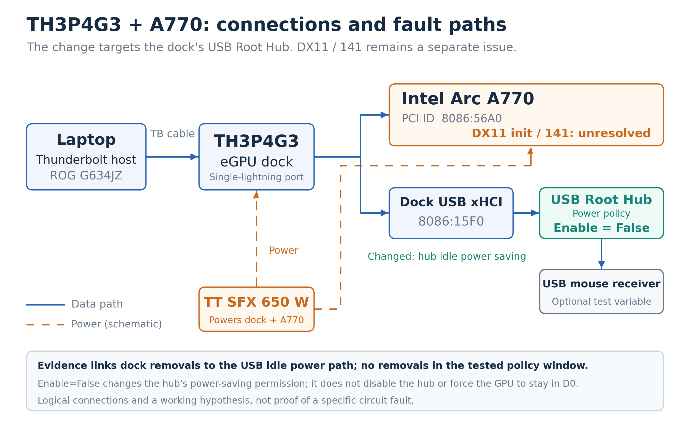
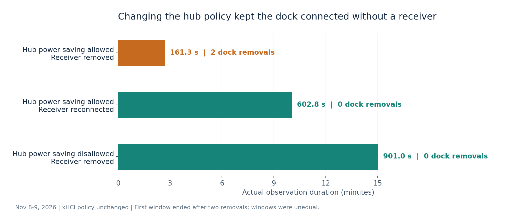
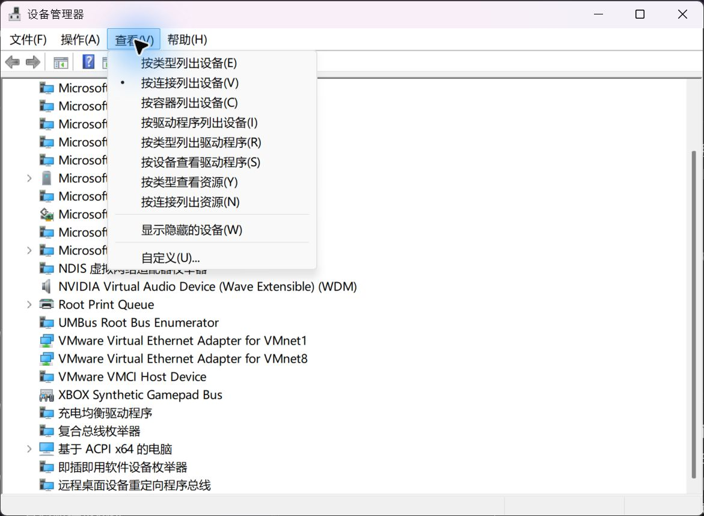
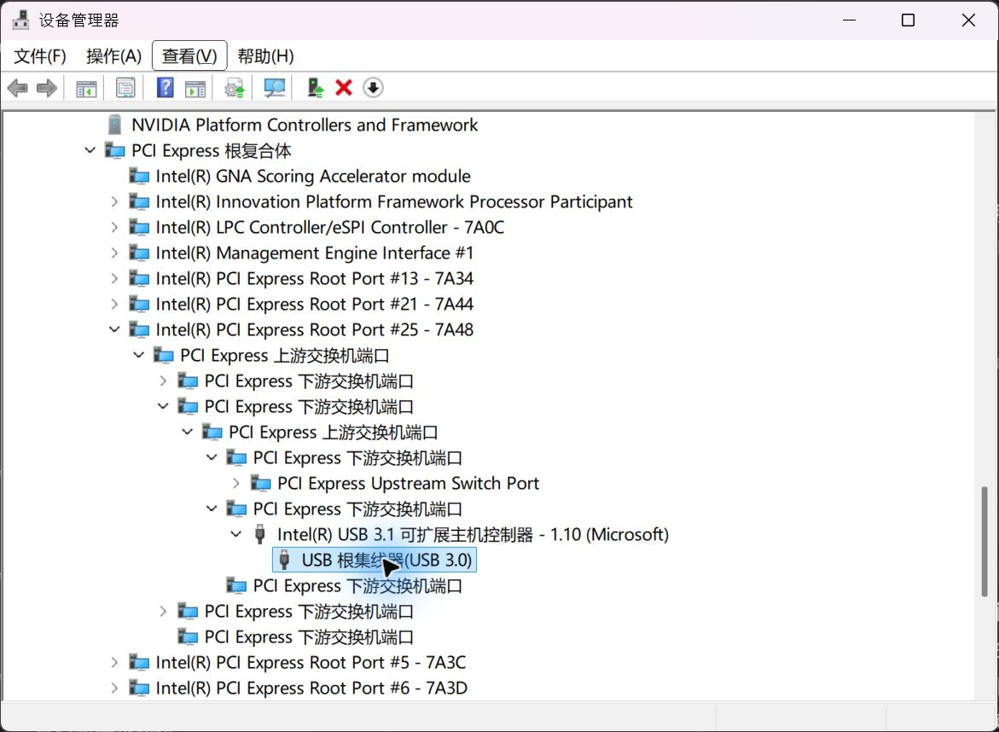
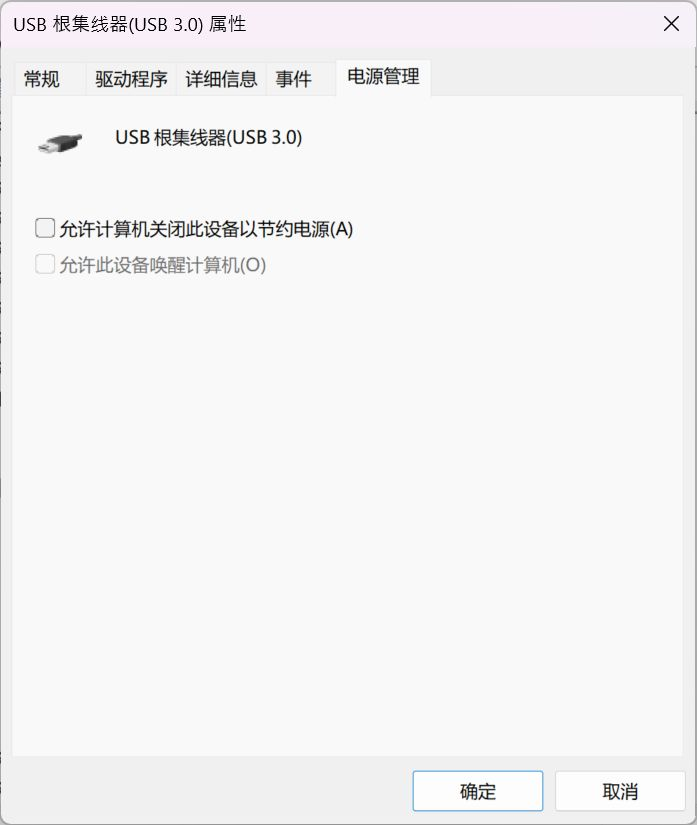
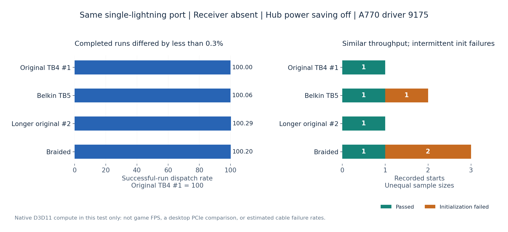
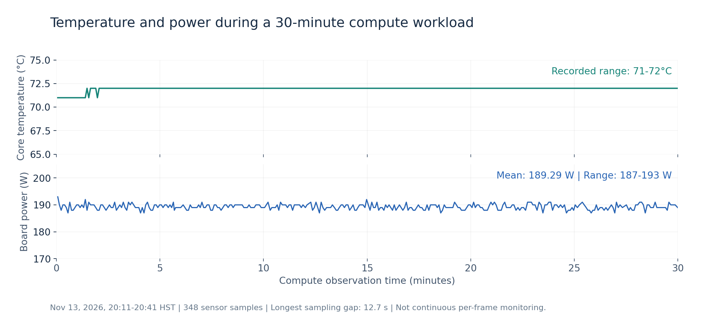

# TH3P4G3 and Intel Arc A770 disconnects and USB power management

[简体中文](README.md) | **English**

[Jump to the Device Manager screenshot guide](#device-manager-guide)

Prepared November 13, 2026. All test times use HST (UTC−10). This is a single-system troubleshooting record covering a working mitigation and a separate unresolved fault.

**On this system, unchecking “Allow the computer to turn off this device to save power” for the dock's USB Root Hub kept the dock connected during the subsequent observation window, even with the mouse receiver unplugged. Intermittent LiveKernelEvent 141 failures during native DX11 initialization remain unresolved.**

## Setup and symptoms

| Component | Test configuration |
| --- | --- |
| Laptop | ASUS ROG Strix G634JZ with an internal RTX 4080 Laptop GPU and Intel UHD Graphics |
| External GPU | Intel Arc A770 Limited Edition 16 GB, driver 32.0.101.9175 |
| Dock | TH3P4G3. A GZOSMETA GPU-EG01M was also tested earlier; the power-management findings here concern the TH3P4G3. |
| Power supply | Thermaltake (TT) 650 W SFX, 80 PLUS Gold, shared between both docks; identification supplied by the owner |
| OS | Windows 11 Insider Preview. Build numbers were not fully archived for every phase, so these findings should not be generalized to all Windows versions. |
| Controlled settings | ReBAR disabled. Cable comparisons used the same driver and the dock's single-lightning-symbol port, with the receiver unplugged and Root Hub power saving disabled. |

The dock sometimes made a faint clicking sound, followed by repeated Windows USB connect/disconnect sounds. Logs confirmed removal of the dock and its downstream devices in some periods. A second failure mode involved DX11 initialization failing while the dock and GPU remained enumerated. These are counted separately.



Figure 1. Logical connections, not an electrical schematic. The USB branch's power policy and the A770's own power state are separate. The diagram does not establish a defective circuit or component.

## Why the USB receiver mattered

Repeated disconnects became much less frequent after a USB mouse receiver was plugged into the dock. To investigate idle power management, the receiver was first removed and reinserted without changing policy. Only the dock's Root Hub policy was changed for the final phase.

| Phase | Receiver | Hub power saving allowed | Observed duration | Dock removals | New 141 reports |
| --- | --- | --- | --- | --- | --- |
| B | Unplugged | Yes | 161.3 s; stopped after two removals | 2 | 0 |
| A2 | Reinserted | Yes | 602.8 s | 0 | 0 |
| C | Unplugged again | No | 901.0 s | 0 | 0 |

The xHCI controller's original policy was preserved throughout. Phase C readback showed Root Hub `Enable=False` and xHCI `Enable=True`, with no xHCI D3 completion events captured during that observation window. Here, `Enable=False` refers to the power-saving permission, **not disabling the USB device itself**.



**These results support a link between idle power management in the dock's USB branch and removal of the entire dock.** The receiver may have changed the conditions under which that branch entered a low-power state. The evidence does not isolate a particular driver, firmware component, or hardware interaction. D3 is a device low-power state; observing it is not, by itself, evidence of a disconnect. Windows USB selective suspend can suspend individual ports independently. This targeted Hub change is a workaround for this system, not a general recommendation to disable USB power saving globally. [Microsoft USB selective suspend documentation](https://learn.microsoft.com/en-us/windows-hardware/drivers/usbcon/usb-selective-suspend)

The problem recurred on November 12: five dock removals were recorded between 10:43 and 10:53, and the Hub permission was found back at `True`. At 10:54:25 it was set to `False` again, while xHCI remained `True`. **Recheck the actual policy after reconnection, device re-enumeration, or reboot.** The available logs do not establish which action restored the default.

<a id="device-manager-guide"></a>

## How to try the workaround and verify it

These are actual screenshots of this system's **Chinese Windows interface**, with the corresponding English menu names below. The target is **the USB Root Hub inside the dock**, not the laptop's built-in Hub, the A770, or the xHCI controller itself.

### 1. Show devices by connection

Right-click Windows Start and open **Device Manager**. Select **View → Devices by connection** (shown as **查看 → 按连接列出设备**). This view exposes parent/child relationships so that identically named hubs can be distinguished.



### 2. Locate the dock's USB Root Hub

The expanded path on this system is shown below. **Root Port #25 is specific to this laptop; other systems may use a different path or port number.** The tree may not display the name “TH3P4G3.”

```text
ACPI x64-based PC
└─ Microsoft ACPI-Compliant System
   └─ PCI Express Root Complex
      └─ Intel(R) PCI Express Root Port #25 - 7A48
         └─ Multiple PCI Express Upstream/Downstream Switch Ports
            └─ Intel(R) USB 3.1 eXtensible Host Controller - 1.10 (Microsoft)
               └─ USB Root Hub (USB 3.0) ← Target of this change
```



To check the controller, right-click the parent **USB 3.1 eXtensible Host Controller → Properties → Details → Hardware Ids** (**属性 → 详细信息 → 硬件 Id**). This dock controller's ID contains `VEN_8086&DEV_15F0`. Use this as supporting identification, not as the sole reason to change a device on another system. A receiver plugged into the dock's USB port can also help identify its Hub through the parent chain. Once confirmed, return to the **USB Root Hub** below the controller.

### 3. Clear the power-saving checkbox and verify

Right-click the target **USB Root Hub → Properties → Power Management** (**属性 → 电源管理**). Clear **Allow the computer to turn off this device to save power** (**允许计算机关闭此设备以节约电源**), then click **OK**. Reopen the same page to confirm that the box remains unchecked.



The screenshot shows the saved, unchecked state; no policy was changed to take these screenshots. Readback at capture time showed Hub `Enable=False` and xHCI `Enable=True`. Here, `False` removes the power-saving permission; it does **not** mean “Disable device.” If the Power Management tab is absent, check the device tree and driver first rather than disabling devices in bulk.

After saving, unplug any receiver used for identification. Keep the cable, port, driver, and PSU unchanged, and observe idle behavior, load, and post-load idle behavior. Change one variable at a time and record manual unplug/replug times. **Recheck the same Hub after reconnection, re-enumeration, or reboot.** To revert, restore the original checkbox setting.

The change took effect without a reboot in phase C. It restricts the system's ability to power down that Hub while idle. **It does not force the A770 to remain in D0, and it does not prevent normal shutdown or safe ejection.** Phase C did not depend on raising GPU power limits, enabling ReBAR, or changing the graphics driver.

## Cable comparisons and the unresolved 141 failures

Matched runs used the same native D3D11 compute test, explicitly selecting the A770, Feature Level 11_0, 64 dispatches per batch, and a target duration of 300 seconds. Follow-up observation lasted roughly two minutes after the program exited, with three rounds of 128 MiB bidirectional copy verification where completed. Dispatch counts describe this program's workload; they are not game frames.

| Cable, single-lightning-symbol port | Recorded initialization outcomes | Dispatches in the successful long run | Host → GPU | GPU → host |
| --- | --- | --- | --- | --- |
| Original Thunderbolt 4 cable #1 | One success | 2,163,136 | 1.546 GiB/s | 2.342 GiB/s |
| Belkin Thunderbolt 5 cable | Failed, then passed on retry | 2,164,416 | 1.544 GiB/s | 2.343 GiB/s |
| Longer original cable #2 | One success | 2,169,344 | 1.548 GiB/s | 2.346 GiB/s |
| Braided cable | Failed twice, then passed | 2,167,488 | 1.547 GiB/s | 2.347 GiB/s |

Copy rates were calculated from each round's median GPU timestamp duration, then the median of the three rounds. They are not the Thunderbolt link's advertised bandwidth. Dispatch rates in the four completed runs differed by less than 0.3%. The small, non-randomized sample cannot rank cable failure rates or quantify performance loss relative to a desktop PCIe slot.



The braided cable's third run lasted 300.02 seconds and passed readback verification. Its 43 process-engine utilization samples averaged 96.47%. It was followed by about 158 seconds of idle observation and the copy tests. No new 141 or dock removal was recorded between 14:01:39 and 14:09:43 on November 12. Each of the two earlier initialization failures had a corresponding 141. Another report at 13:48 fell outside those three benchmark windows; the later successful run does not erase those failures.

Separately, original cable #1 completed 300 seconds of load on the **battery-plus-lightning-symbol port**, but a 141 appeared about 64 seconds after the load ended. That run is excluded from the same-port comparison above. It shows why **checking only the stress-test runtime can miss a fault after the program exits**.

Failed initialization commonly returned `DXGI_ERROR_DEVICE_REMOVED (0x887A0005)`. Multiple reports shared this signature:

```text
LKD_0x141_Tdr:6_IMAGE_igdkmdnd64.sys_GEN12_TRINITY11_GUC_SCHEDULER_ERROR
```

Microsoft defines `0x141` as a live-dump identifier indicating that a display engine did not respond in time. It does not establish that a graphics card is defective. Likewise, `DEVICE_REMOVED` here is not a substitute for evidence of device removal from the PnP tree. The signature points to Intel's graphics scheduling path, but does not by itself assign the root cause to software or hardware. [Microsoft 0x141 documentation](https://learn.microsoft.com/en-us/windows-hardware/drivers/debugger/bug-check-0x141---video-engine-timeout-detected)

## Additional stability tests completed

| Test | Observed result | Scope |
| --- | --- | --- |
| OCCT 3D Adaptive | 20 min 01 s; no detected errors, new disconnects, or 141 reports | Earlier phase with the receiver connected, not a repeat under the later cable-test conditions |
| OCCT VRAM | 15 min at 80%; about 12.47 GiB average dedicated memory use; no detected errors, new disconnects, or 141 reports | Same earlier phase; supports stability within that test's coverage |
| DX12 standby/wake | Five cycles, each starting after recorded A770 D3 and running 30 s; all passed readback | Receiver-connected phase; does not replace DX11 initialization testing |
| Kryptex compute | 30 min; 144 device checks without faults, no new 141 or disconnects | Separate supplemental capture; these files do not re-establish the cable and port used |



The compute observation contained 348 sensor samples. Core temperature ranged from 71–72°C; board power averaged 189.29 W and ranged from 187–193 W. This demonstrates completion of that sustained workload. It does not rule out faults triggered only during initialization, idle, or workload transitions.

## Reading the logs and limiting the conclusion

Monitoring covered PCI power transitions, Thunderbolt events, PnP removals, device presence, and Windows Error Reporting (WER). Counts follow these rules:

- **Dock disconnects:** match PnP event 1010 to the target bridge and correlate it with presence changes for the dock, xHCI controller, and A770. Exclude manual cable changes and safe ejection.
- **GPU timeouts:** filter WER for `EventName=LiveKernelEvent` and `P1=141`, deduplicate by `ReportId`, and correlate with the failure time in the dump or `Report.wer`.
- **D3 and RTD3:** record which device transitioned and when. A power-transition event alone does not count as a physical disconnect.
- **Observation windows:** separate initialization, load, and post-exit observation. The system clock had changed during earlier work, so UTC timestamps and event RecordIds were used where needed to establish ordering.

For example, two WER records logged at 20:40 during the 30-minute compute observation referred to older failures at 05:26 and 05:38 that day. Matching report identities and `Report.wer` `EventTime` confirmed this; they were not counted as new 141 failures during that test.

**The useful result is a dock-disconnect workaround supported by controlled observations, plus a method for separating dock removal from DX11 timeouts.** These tests do not establish that all 141 failures are fixed, rule out PSU or GPU hardware faults, or guarantee the same behavior on every TH3P4G3. Intel also lists Arc eGPU configurations as not officially supported. That defines support scope; it does not diagnose this system's fault. [Intel eGPU support statement](https://www.intel.com/content/www/us/en/support/articles/000098033/graphics.html)

## Data and reproduction

[evidence.json](evidence.json) contains extracted test windows, counts, long-run and copy results, sensor samples, and SHA-256 hashes of source files. Usernames, computer names, unique device-instance suffixes, and WER report identifiers have been removed from the published attachments. Raw event XML and memory dumps are not included. Original cable labels remain in the shared JSON; the English plotting script maps them to the English names shown above.

The Chinese report and its figures remain available. The scripts read local report data and generate figures or HTML; they do not query or modify hardware.

| Script | Output |
| --- | --- |
| `build_figures.py` | Chinese data figures and both HTML reports |
| `build_topology.py` | Chinese topology diagram |
| `build_english.py` | Four English figures in PNG/SVG and both HTML reports |
| `render_reports.py` | HTML only: `report.html` and `report.en.html` |

Use Python with Matplotlib and Python-Markdown. English figures use DejaVu Sans; Chinese figures need Microsoft YaHei or Noto Sans CJK SC. To regenerate the English edition from the repository directory:

```bash
python -m pip install matplotlib Markdown
python build_english.py
```

`assets/device-manager/` contains actual Windows screenshots shared by both languages. They are captured UI images, not interface mockups generated by the plotting scripts.

The custom D3D11 test program, hardware-specific ejection script, and complete raw logs are not bundled. Reproducing the exact benchmark counts requires the corresponding test-program version. To validate the disconnect workaround, prioritize the receiver/Hub-policy comparison rather than matching dispatch counts.
