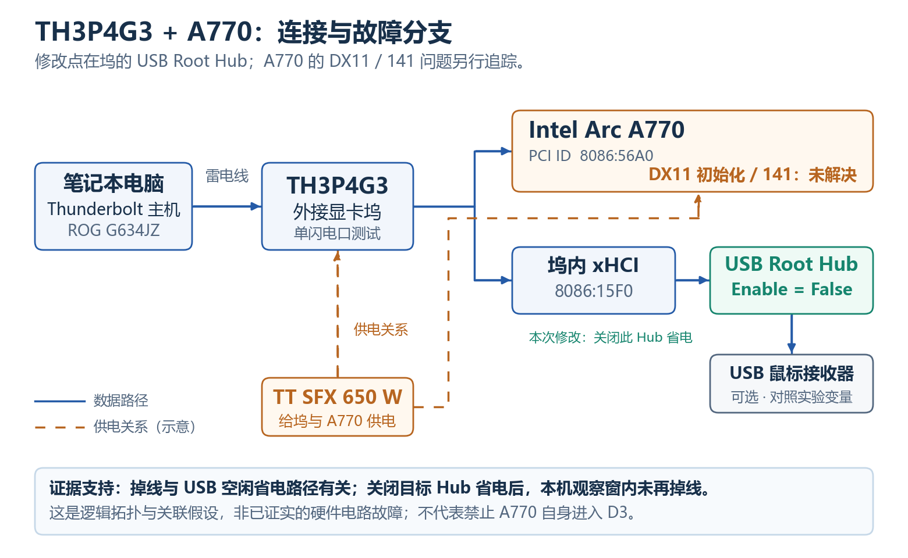
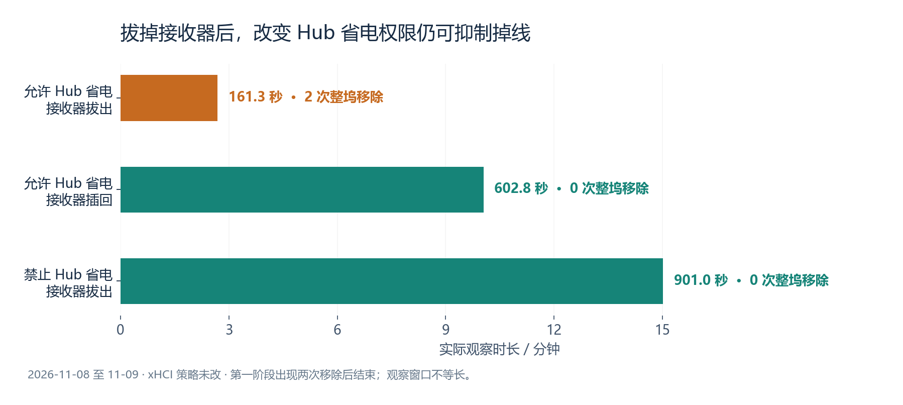
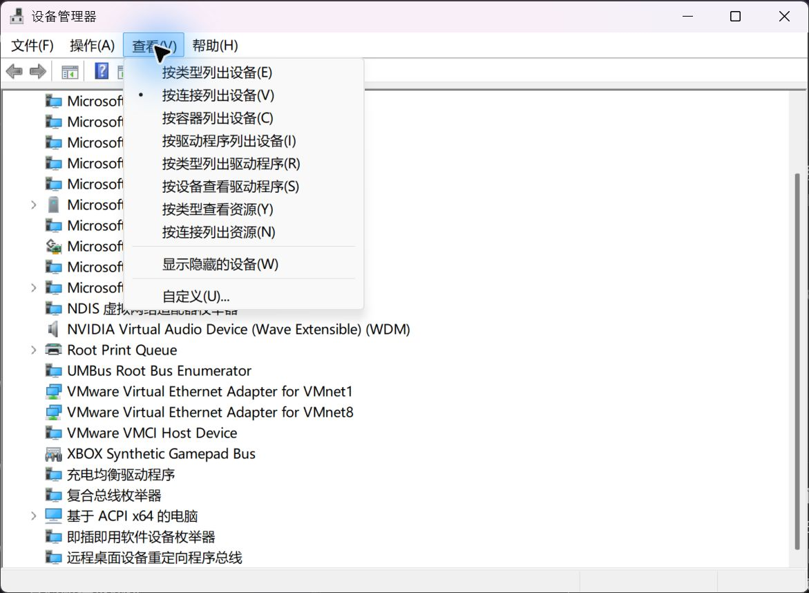
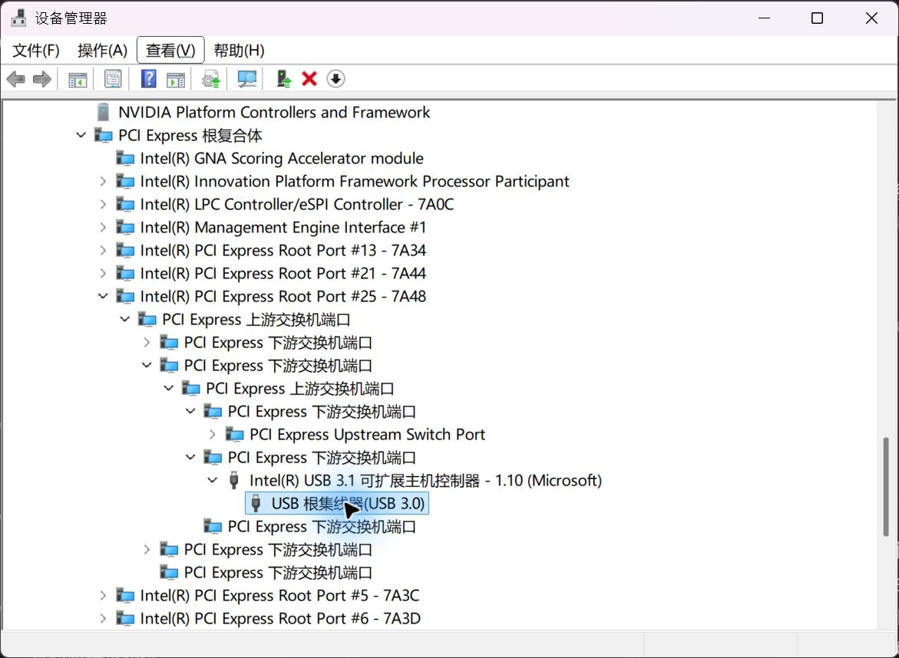
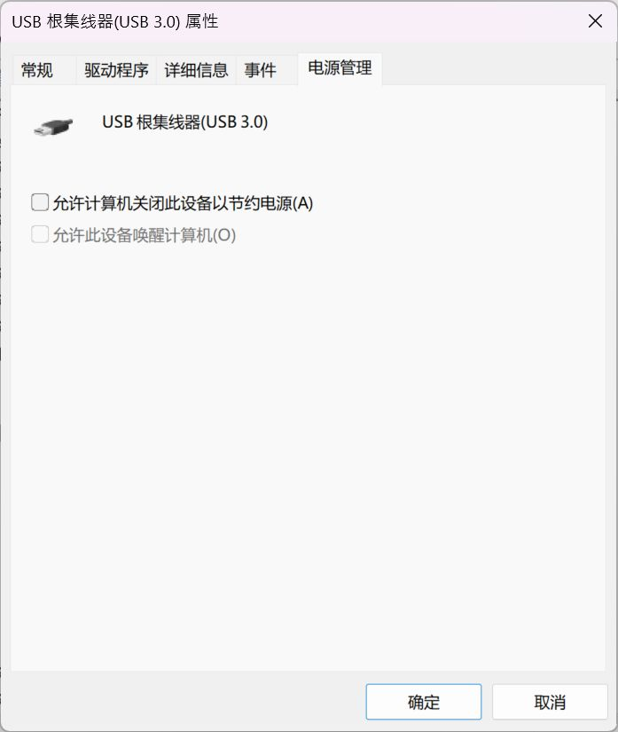
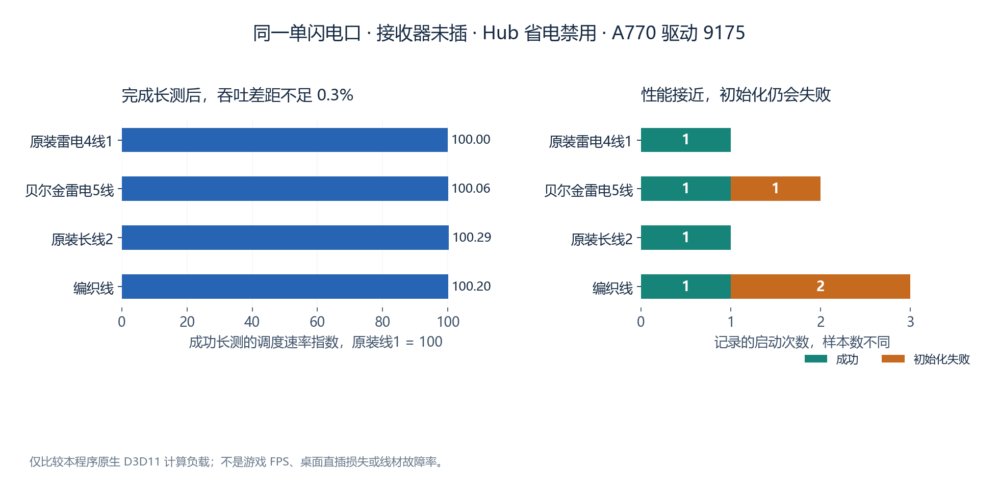
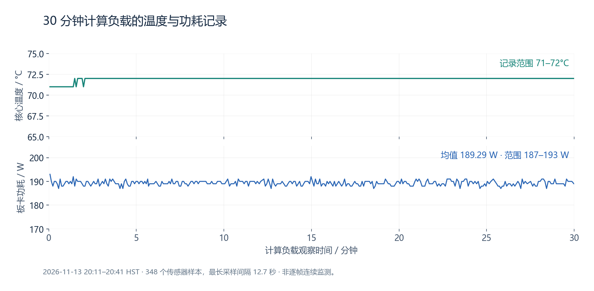

# TH3P4G3 外接 A770 反复掉线排查与省电设置验证

**简体中文** | [English](README.en.md)

[直接看：设备管理器关闭省电的截图步骤](#device-manager-guide)

2026 年 11 月 13 日整理。测试时间使用 HST（UTC−10）。这是单机排障记录，包含有效的绕过方法和仍未解决的问题。

**这台电脑上，取消显卡坞 USB Root Hub 的“允许计算机关闭此设备以节约电源”后，拔掉鼠标接收器也在后续观察窗口内保持了连接。原生 DX11 初始化时的 LiveKernelEvent 141 仍偶发，不能宣布显卡所有问题已解决。**

## 设备与最初症状

| 项目 | 实验环境 |
| --- | --- |
| 笔记本 | ASUS ROG Strix G634JZ，内置 RTX 4080 Laptop 与 Intel UHD |
| 外接显卡 | Intel Arc A770 Limited Edition 16 GB，驱动 32.0.101.9175 |
| 显卡坞 | TH3P4G3；早期还测试过 GZOSMETA GPU-EG01M，本文的省电结论针对 TH3P4G3 |
| 电源 | TT 额定 650 W SFX 80 PLUS 金牌，两套显卡坞共用，型号由使用者提供 |
| 系统 | Windows 11 Insider Preview；各阶段构建号未完整归档，不将结果外推到全部 Windows 版本 |
| 本轮保持的设置 | ReBAR 未开启；线材对比阶段固定驱动、单闪电口、接收器拔出、Hub 省电禁用 |

使用中，显卡坞先出现轻微咔哒声，随后 Windows 反复播放 USB 连接与断开的提示音；部分时段日志确认整个坞及下游设备被移除。另有一种故障表现为 DX11 程序初始化失败，但坞和显卡仍在设备树中。两类现象需要分别统计。



图 1：逻辑连接示意。USB 分支的省电设置与 A770 自身的电源状态属于不同对象；图中关系不代表已经定位到某个硬件电路故障。

## 接收器为何成为线索

插入 USB 鼠标接收器后，频繁通断明显减少。为了验证是否与空闲省电有关，先保持原策略拔插接收器，再只修改坞内 Root Hub 的权限。

| 阶段 | 接收器 | Hub 允许省电 | 实际观察 | 整坞移除 | 新 141 |
| --- | --- | --- | --- | --- | --- |
| B | 拔出 | 是 | 161.3 秒，出现两次移除后结束 | 2 | 0 |
| A2 | 插回 | 是 | 602.8 秒 | 0 | 0 |
| C | 再拔出 | 否 | 901.0 秒 | 0 | 0 |

三个阶段均保留 xHCI 控制器原策略。阶段 C 的回读为 Root Hub `Enable=False`、xHCI `Enable=True`，并记录到观察期内没有 xHCI D3 完成事件。



**这组结果支持“显卡坞 USB 分支的空闲电源管理与整坞掉线有关”。** 接收器可能改变了该分支进入低功耗的条件；具体是驱动、固件还是硬件协同问题，尚未确定。D3 本身是设备低功耗状态，不能直接当作掉线。Windows 的 USB 选择性挂起机制可以独立挂起端口；这里对特定 Hub 的调整是本机绕过方法，并非全局关闭 USB 省电的通用建议。[Microsoft USB 电源管理说明](https://learn.microsoft.com/en-us/windows-hardware/drivers/usbcon/usb-selective-suspend)

11 月 12 日还出现过一次复发：10:43–10:53 记录到 5 次整坞移除，检查时 Hub 权限已回到 `True`。10:54:25 再次设为 `False`，xHCI 保持 `True`。这说明**重连、重新枚举或重启后应复查实际设置**；现有日志不足以确定是哪一步使其恢复默认值。

<a id="device-manager-guide"></a>

## 其他用户如何尝试和复核

以下为本机设备管理器的真实截图。修改对象是**显卡坞内的 USB 根集线器**，不是笔记本内置 Hub，也不是 A770 或 xHCI 控制器本身。

### 1. 按连接列出设备

右键 Windows 开始按钮，打开“设备管理器”，选择顶部菜单 **“查看 → 按连接列出设备”**。这个视图显示设备之间的父子关系，便于区分多个同名 Hub。



### 2. 找到显卡坞的 USB 根集线器

本机展开路径如下；**Root Port #25 是这台电脑的路径，不是其他电脑必须寻找的端口编号**。设备树中也不一定直接出现“TH3P4G3”名称。

```text
基于 ACPI x64 的电脑
└─ Microsoft ACPI-Compliant System
   └─ PCI Express 根复合体
      └─ Intel(R) PCI Express Root Port #25 - 7A48
         └─ 多级 PCI Express 上游／下游交换机端口
            └─ Intel(R) USB 3.1 可扩展主机控制器 - 1.10 (Microsoft)
               └─ USB 根集线器 (USB 3.0) ← 本次修改对象
```



为核对控制器，可右键上一级 **USB 3.1 可扩展主机控制器 → 属性 → 详细信息 → 硬件 Id**；本机坞内控制器的标识包含 `VEN_8086&DEV_15F0`。这只用于辅助辨认，不能只凭名称或该 ID 修改其他机器的设备。也可把接收器插入坞的 USB 口，沿其父级路径确认所属 Hub。确认后返回下一级 **USB 根集线器**。

### 3. 取消省电勾选并复核

右键目标 **USB 根集线器 → 属性 → 电源管理**，取消勾选 **“允许计算机关闭此设备以节约电源”**，再点“确定”。重新打开同一页，确认仍未勾选。



截图展示的是已保存的未勾选状态，采集截图时没有改变策略；同时回读为 Hub `Enable=False`、xHCI `Enable=True`。这里的 `False` 是取消省电权限，**不是“禁用设备”**。如果没有“电源管理”页签，先核对设备树和驱动，不要批量禁用设备。

保存后，拔掉用于辨认的接收器，保持线材、端口、驱动和电源不变，依次观察空闲、负载、负载结束后的空闲。每次只改变一个变量，并记下手动拔插时间。**重连、重新枚举或重启后再次确认同一 Hub 的设置**。需要恢复原状时，勾回原选项即可。

本次修改立即生效，阶段 C 没有先重启。它限制的是目标 Hub 在空闲时被系统省电关闭，**不等于让 A770 永远保持 D0，也不妨碍正常关机和安全弹出**。本次未依靠提高功耗、开启 ReBAR 或更换驱动来取得阶段 C 的结果。

## 线材对比与尚未解决的 141

统一条件下，使用同一个原生 D3D11 计算测试程序，指定 A770、Feature Level 11_0、每批 64 次 dispatch，目标时长 300 秒。退出后继续观察约两分钟，并做三轮 128 MiB 双向复制校验。程序报告的 dispatch 数是本程序工作量，不是游戏帧数。

| 单闪电口线材 | 已记录的初始化 | 成功长测 dispatch 数 | 主机→显卡 | 显卡→主机 |
| --- | --- | --- | --- | --- |
| 原装雷电 4 线 1 | 1 次成功 | 2,163,136 | 1.546 GiB/s | 2.342 GiB/s |
| 贝尔金雷电 5 线 | 先失败，重试成功 | 2,164,416 | 1.544 GiB/s | 2.343 GiB/s |
| 原装长线 2 | 1 次成功 | 2,169,344 | 1.548 GiB/s | 2.346 GiB/s |
| 编织线 | 先失败两次，第三次成功 | 2,167,488 | 1.547 GiB/s | 2.347 GiB/s |

复制速率用每轮 GPU 时间戳中位数，再取三轮中位数换算；它不是整条雷电链路的标称带宽。四种线材成功长测的调度速率差距不足 0.3%。样本少、顺序未随机，不能据此给线材故障率排名，也不能推算相对台式机直插的性能损失。



编织线第三次运行持续 300.02 秒，43 个进程引擎利用率样本平均 96.47%，读回校验通过；结束后空闲约 158 秒，再完成复制测试。14:01:39–14:09:43 窗口内没有新增 141 或整坞移除。此前两次初始化各对应一个 141，13:48 还有一个不属于这三次基准窗口的报告，不能因第三次通过而将它们忽略。

另外，原装线 1 在“电池＋闪电”口完成了 300 秒负载，但结束约 64 秒后出现 141。这个结果不纳入上表的同端口性能比较，却说明**只看压力测试过程、不检查退出后的日志，会漏掉故障**。

失败时常见返回值为 `DXGI_ERROR_DEVICE_REMOVED (0x887A0005)`，多个报告具有以下签名：

```text
LKD_0x141_Tdr:6_IMAGE_igdkmdnd64.sys_GEN12_TRINITY11_GUC_SCHEDULER_ERROR
```

Microsoft 将 `0x141` 定义为显示引擎未及时响应的 live dump 标识。它并不直接证明显卡损坏；这里的 `DEVICE_REMOVED` 也不能替代设备树中的物理移除证据。现阶段只能确认故障落在 Intel 图形调度路径，不能仅凭签名定责到驱动或硬件。[Microsoft 0x141 说明](https://learn.microsoft.com/en-us/windows-hardware/drivers/debugger/bug-check-0x141---video-engine-timeout-detected)

## 已完成的补充稳定性测试

| 测试 | 实际结果 | 适用范围 |
| --- | --- | --- |
| OCCT 3D Adaptive | 20 分 01 秒，无检测错误，无新增掉线或 141 | 接收器插着的早期阶段，不等于当前接法的重复试验 |
| OCCT VRAM | 15 分钟，设置 80%，平均使用约 12.47 GiB，无检测错误或新增掉线、141 | 同上，支持该测试覆盖范围内的显存稳定性 |
| DX12 待机唤醒 | 5 轮；每轮确认 A770 处于 D3 后运行 30 秒，均读回通过 | 接收器插着的阶段；不能替代 DX11 初始化测试 |
| Kryptex 计算 | 30 分钟，144 次设备检查无异常，无新 141 或断连 | 独立补充记录，未由该组文件重新确认线材和端口 |



30 分钟计算期间有 348 个传感器样本，温度 71–72°C，板卡功耗平均 189.29 W、范围 187–193 W。它说明这套设备能完成该次持续计算；无法排除只在初始化、空闲或切换时触发的问题。

## 日志判读与结论边界

监测同时记录 PCI 电源转换、Thunderbolt 事件、PnP 移除、设备在位状态以及 Windows Error Reporting（WER）。计数时采用以下规则：

- 整坞掉线：匹配目标桥接设备的 PnP 1010，并结合坞、xHCI、A770 的在位变化；排除人为拔线和安全弹出。
- GPU 超时：筛选 WER 的 `EventName=LiveKernelEvent`、`P1=141`，按 `ReportId` 去重，关联转储或 `Report.wer` 的故障发生时间。
- D3 与 RTD3：记录其发生对象和时间；单独出现电源转换事件不算实际掉线。
- 时间窗口：分开初始化、负载和退出后的观察。系统曾有时钟变化，因此必要时结合 UTC 和事件 RecordId 判断顺序。

例如 30 分钟计算窗口内 20:40 出现的两条 WER 记录，经同报告标识及 `Report.wer` 的 `EventTime` 核对，对应当天 05:26 和 05:38 的旧故障，不计入这次测试的新 141。

**可分享的成果是一个有对照数据支持的整坞掉线绕过方法，以及将整坞掉线与 DX11 超时分开验证的方法。** 目前还不能宣称修复所有 141、排除电源或显卡硬件问题，或适用于全部 TH3P4G3。Intel 的官方文档也将 Arc eGPU 列为未正式支持的配置；这是适用范围说明，不是本机故障原因的证明。[Intel eGPU 支持说明](https://www.intel.com/content/www/us/en/support/articles/000098033/graphics.html)

## 数据与复用

[evidence.json](evidence.json) 提供从本地日志提取的实验时段、计数、长测与复制结果、传感器样本及来源文件 SHA-256。公开附件已去掉用户名、电脑名称、设备实例唯一后缀和 WER 报告唯一标识；原始事件 XML 与内存转储未打包。

`build_figures.py` 从这份摘要重建三张中文数据图；中文拓扑图由 `build_topology.py` 生成。`build_english.py` 生成四张英文配图，两种语言共用同一份数据。`render_reports.py` 可单独重建中文 `report.html` 和英文 `report.en.html`，两个数据绘图脚本也会调用它。使用 Python、Matplotlib、Python-Markdown；中文图需要微软雅黑或 Noto Sans CJK SC，英文图使用 DejaVu Sans。脚本只读取本目录文件和生成图片、HTML，不查询或修改设备。

`assets/device-manager/` 保存实际 Windows 界面截图，中英文版共用；这些截图不是绘图脚本生成的界面示意。

本文中的测试程序参数足以解释比较口径，但本目录没有打包自定义 D3D11 测试程序、硬件绑定的弹出脚本或全部原始日志；独立复现精确跑分仍需要对应程序版本。验证掉线绕过时，应优先重现接收器／Hub 策略对照，而不是追求相同 dispatch 数。
