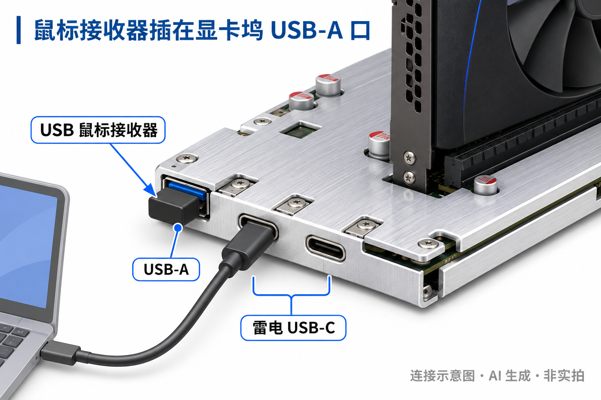

# Can a USB mouse receiver prevent dock disconnects?

[简体中文](usb-receiver-workaround.md) | **English** | [Back to README](../README.en.md)

**For the repeated whole-dock disconnect/reconnect observed while this system was idle, leaving an existing wireless mouse receiver in the TH3P4G3 USB-A port is a simple workaround supported by this system's measurements. It is not an established fix for DX11 initialization failures or all `LiveKernelEvent 141` errors.**

## Receiver and connection



This is an AI-generated connection illustration, **not a photograph or evidence from temperature, stability or hot-plug testing**. It follows the port arrangement in the seller’s [interface diagram](https://sc04.alicdn.com/kf/H248af1e2a8c14b318e56c6ef826980b8n/220568862/H248af1e2a8c14b318e56c6ef826980b8n.jpg) and [installation sheet](https://sc04.alicdn.com/kf/Hfe76b3ce36b64c9c83d3a79b72660610m/220568862/Hfe76b3ce36b64c9c83d3a79b72660610m.jpg), published on the [MinixPC product page](https://minixpc.com/products/upgraded-th3p4g3-thunderbolt-compatible-gpu-video-card-dock-laptop-to-external-graphic-card-for-macbook-notebook-pd-60w-40gbps). The receiver uses the rectangular USB-A; the adjacent USB-C ports provide Thunderbolt/PD and Thunderbolt daisy-chaining. Enclosure cutouts can vary; check the actual port shape and markings.

The [generation prompt and method](../assets/receiver-in-dock-usb-a.prompt.md) document how this illustration was generated.

The photograph below separately shows a real receiver:

[](https://commons.wikimedia.org/wiki/File:Logitech_unifying_receiver.jpg)

Photo: MiNe (sfmine79), [Wikimedia Commons source and license](https://commons.wikimedia.org/wiki/File:Logitech_unifying_receiver.jpg), [CC BY 2.0](https://creativecommons.org/licenses/by/2.0/). Unmodified, externally embedded. This identifies the type of accessory; **it does not identify the receiver used in this experiment or endorse a brand**. Its license is separate from the tools' MIT license.

```text
Laptop ── Thunderbolt cable ── TH3P4G3 dock ── A770
                                  │
                                  └─ USB-A port ← wireless mouse USB receiver
```

Connect it to a USB data port on the **dock**. Start with a working receiver already paired with your mouse. Connecting a mouse directly to the computer over Bluetooth does not add a device to the dock's USB branch. Arbitrary receivers, unpaired receivers and other USB placeholders have not been shown to produce the same result.

Ejecting the dock also temporarily disconnects its mouse; the laptop touchpad remains an alternative input. The receiver does not replace closing GPU applications, checking attached peripherals or waiting for device code 47 before unplugging. Since v0.2.0, a receiver that passes the checks below can remain connected without removal or a manually entered allowlist.

## Automatic receiver recognition and storage protection

The tool starts at each device directly below the dock USB root hub and checks its complete subtree. Automatic acceptance requires **every node to be present and healthy, every USB hardware interface to be HID, and at least one standard mouse collection**, with the strictly checked software-component leaves described below permitted alongside them. This includes compatible mouse receivers and combined mouse/keyboard receivers. A keyboard-only device, game controller or generic HID node alone is insufficient.

Windows device classes cannot reliably distinguish a wireless mouse receiver from a wired HID mouse, so a wired mouse meeting the same conditions can also pass. Classification uses functions, rather than friendly names such as “Receiver,” brands or device-instance allowlists.

| Finding | Handling before ejection |
| --- | --- |
| Directly connected device with HID-only USB hardware interfaces and a standard mouse collection; all nodes healthy | Accept automatically; it disconnects temporarily with the dock |
| USB storage, UASP/SCSI storage, a disk or volume | Block; finish I/O and safely remove storage separately |
| A composite device combining HID with storage or another hardware function | Block the whole device; a mouse interface alone is insufficient |
| An additional USB hub, unknown interface, incomplete enumeration or unhealthy node | Block until its connection and state can be verified |

Windows may attach a `SoftwareComponent` to a receiver, such as an `SWD\DRIVERENUM` virtual child. The tool accepts only a healthy leaf directly under a verified `HidUsb` interface, with the expected class and identifiers, a matching vendor identifier, no associated function-driver service, no children and the correct parent relationship. **This is not blanket acceptance of `SWD` nodes**, and it never exempts sibling interfaces from inspection.

“No associated function-driver service” means the device’s `DEVPKEY_Device_Service` is empty; it does not mean the package has no services at all. Microsoft documents that software components can also install Win32 services. A software component is not another USB hardware interface. [Microsoft: Using a Component INF File](https://learn.microsoft.com/en-us/windows-hardware/drivers/install/using-a-component-inf-file)

Legacy `AllowedUsbInstanceIds` entries **no longer bypass classification or storage checks**. Downstream Thunderbolt accessory checks also remain active. The policy evaluates functions currently enumerated by Windows; it does not guarantee recognition of every vendor-specific receiver or nonstandard driver. Uncertain devices are blocked. Run `-Action Status` and `-Action Eject -WhatIf` to inspect the decision; preview mode does not close applications or eject devices.

The classification is based on Microsoft’s [HID top-level collection hardware IDs](https://learn.microsoft.com/en-us/windows-hardware/drivers/hid/hidclass-hardware-ids-for-top-level-collections), [USB composite parent driver](https://learn.microsoft.com/en-us/windows-hardware/drivers/usbcon/usb-common-class-generic-parent-driver), and [Windows USB class drivers](https://learn.microsoft.com/en-us/windows-hardware/drivers/usbcon/supported-usb-classes). Mouse functions, composite interfaces and storage drivers are checked separately: one mouse node does not prove that the same device has no storage function.

## Measurements from this system

These are existing measurements in [evidence.json → ab_experiment](../evidence.json), not new tests performed while editing this document. The xHCI controller policy was unchanged in all three phases.

| Phase | Receiver | Dock Root Hub allowed to save power | Observation | Whole-dock removals | New 141 |
| --- | --- | --- | --- | --- | --- |
| B | Removed | Yes | 161.3 s | 2 | 0 |
| A2 | Inserted | Yes | 602.8 s | 0 | 0 |
| C | Removed again | No | 901.0 s | 0 | 0 |

The results support trying the receiver workaround on this system. To keep the USB port free, the alternative tested here was changing only the dock Root Hub's power permission, following the [Device Manager guide](../README.en.md#device-manager-guide). The phases had different lengths and few samples, so they cannot establish a long-term failure rate. The logs also do not establish whether mouse activity is necessary for the receiver's effect.

## What external sources establish

The seller’s installation material confirms a USB 3.0 expansion port and two Thunderbolt ports, but makes no promise that a mouse receiver fixes disconnects or 141. It is identified here as seller-published material; a third-party manual mirror is not treated as an official manufacturer manual. The material supports port identification, while the local comparison supports the observed workaround.

Microsoft documents per-port USB selective suspend and notes that an unsuspended device may keep a host controller's transfer schedule active. **Our inference** is that the receiver changed the conditions for this USB branch to enter low power; the underlying driver, firmware or hardware cause remains unproven. Microsoft recommends leaving selective suspend enabled, so this guide does not prescribe a system-wide disable. [Microsoft: USB selective suspend](https://learn.microsoft.com/en-us/windows-hardware/drivers/usbcon/usb-selective-suspend)

An [original TH3P4G2/G3 review](https://egpu.io/forums/thunderbolt-enclosures/exp-gdc-th3p4g2-thunderbolt-gpu-dock-review/) also describes a wireless mouse connected through the dock and mouse stuttering under heavy peripheral load. It does not establish that a receiver fixes A770 DX11/141 errors. The direct evidence for this workaround is the local comparison above.

`0x141` identifies a display engine that did not respond in time. It does not, by itself, establish a physical whole-dock disconnect. [Microsoft: VIDEO_ENGINE_TIMEOUT_DETECTED](https://learn.microsoft.com/en-us/windows-hardware/drivers/debugger/bug-check-0x141---video-engine-timeout-detected)

## Checking your own system

Keep the cable, port, driver and power supply unchanged. Compare receiver-absent and receiver-present phases during idle and after load ends. Track dock/A770 presence, PnP removals and new 141 reports separately. Exclude manual unplugging, safe ejection and delayed reports of older WER faults.

After whole-dock stability improves, run the separate [DX11 idle/wake test](dx11-wake.en.md). The latest four initializations in this repository passed within their observation window; that result does not establish a causal receiver fix for DX11/141.
