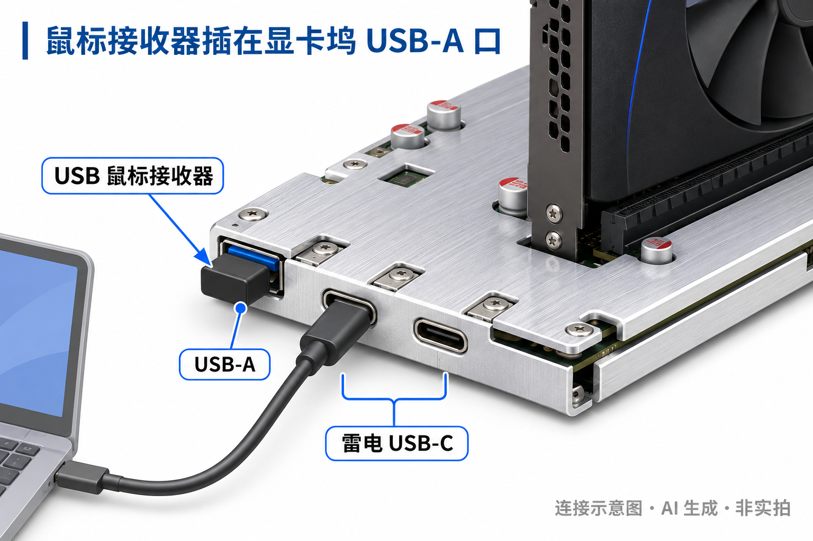

# 插一个 USB 鼠标接收器，能解决掉线吗？

**简体中文** | [English](usb-receiver-workaround.en.md) | [返回主页](../README.md)

**对于本机已经复现的“闲置时整坞反复断开、重连”，把现有无线鼠标的 USB 接收器插在 TH3P4G3 的 USB-A 口，是有实测支持、操作最少的绕过办法。它还不能被称为 DX11 初始化失败或所有 `LiveKernelEvent 141` 的修复。**

## 接收器与插入位置



此图为 AI 生成的连接示意，**不是实物照片，也不是温度、稳定性或插拔测试证据**。它按卖家公开的[接口图](https://sc04.alicdn.com/kf/H248af1e2a8c14b318e56c6ef826980b8n/220568862/H248af1e2a8c14b318e56c6ef826980b8n.jpg)和[安装说明页](https://sc04.alicdn.com/kf/Hfe76b3ce36b64c9c83d3a79b72660610m/220568862/Hfe76b3ce36b64c9c83d3a79b72660610m.jpg)绘制接口关系，完整出处见 [MinixPC 商品资料](https://minixpc.com/products/upgraded-th3p4g3-thunderbolt-compatible-gpu-video-card-dock-laptop-to-external-graphic-card-for-macbook-notebook-pd-60w-40gbps)。接收器插在矩形 USB-A 口；旁边两个 USB-C 是 Thunderbolt/PD 与 Thunderbolt 菊链接口。不同外壳可能改变开孔位置，应以实物端口形状和标识为准。

[生成提示词与方式](../assets/receiver-in-dock-usb-a.prompt.md)记录了该示意图的生成过程。

下面保留接收器本身的真实外观照片：

[](https://commons.wikimedia.org/wiki/File:Logitech_unifying_receiver.jpg)

图片：MiNe（sfmine79），[Wikimedia Commons 原图与许可](https://commons.wikimedia.org/wiki/File:Logitech_unifying_receiver.jpg)，[CC BY 2.0](https://creativecommons.org/licenses/by/2.0/)。图片未修改，通过外链展示。它仅用于辨认这类 USB 接收器，**不是本机测试接收器的型号证明，也不是品牌推荐**；图片许可独立于工具源码的 MIT 许可。

```text
笔记本 ── 雷电线 ── TH3P4G3 显卡坞 ── A770
                         │
                         └─ USB-A 口 ← 插入无线鼠标的 USB 接收器
```

这里说的是插入**显卡坞**的 USB 数据口。沿用已经与鼠标配对、工作正常的接收器即可先做对照；仅把鼠标通过蓝牙连到电脑，并没有在坞的 USB 分支增加设备。尚未验证任意接收器、未配对接收器或其他“占位”USB 设备能否得到相同结果。

安全弹出显卡坞时，坞上的鼠标也会暂时离线，可使用笔记本触控板继续操作。接收器并不替代热拔插工具的应用关闭、外设检查和代码 47 确认。从 v0.2.0 起，符合下述检查的鼠标接收器可保留在坞上，不必每次拔下或手填白名单。

## 自动识别接收器与存储保护

工具从坞 USB 根集线器的直接子设备开始，检查该设备的完整子树。只有**所有节点均在位、状态正常，全部 USB 硬件接口属于 HID，并且至少有一个标准鼠标集合**，才自动放行；允许下述严格核对的软件组件叶节点随同通过。这包括符合条件的鼠标接收器和键鼠共用接收器；仅键盘、游戏手柄或一个泛用 HID 节点本身不够。

Windows 的设备类别不能可靠证明一个 HID 鼠标是无线接收器还是有线鼠标，因此符合相同条件的有线鼠标也可通过。这是按功能分类，不依赖“Receiver”“鼠标”等友好名称，也不要求品牌或设备实例路径白名单。

| 检查结果 | 弹出前的处理 |
| --- | --- |
| 直接连接的 USB 硬件接口全为 HID，含标准鼠标集合，所有节点正常 | 自动放行，随显卡坞一起暂时离线 |
| USB 存储、UASP/SCSI 存储、磁盘或卷 | 阻止弹出；先完成读写并单独安全移除 |
| 同一复合设备同时含 HID 与存储或其他硬件功能 | 阻止整个设备，不能只看其中的鼠标接口 |
| 额外 USB Hub、未知接口、枚举不全或未就绪节点 | 阻止弹出，查清连接和设备状态后重试 |

Windows 可为接收器附加 `SoftwareComponent` 软件组件，例如 `SWD\DRIVERENUM` 虚拟子设备。工具仅允许位于已核对 `HidUsb` 接口之下、类别与标识符合预期、厂商标识与接收器一致、无关联功能驱动服务、没有子设备且父关系正确的在线正常叶节点。**不是所有 `SWD` 节点都放行**，也不会因此跳过同一接收器的其他接口检查。

这里的“无关联功能驱动服务”指设备的 `DEVPKEY_Device_Service` 为空，不表示软件包完全没有服务。Microsoft 说明软件组件还可以安装 Win32 服务；软件组件不是额外的 USB 硬件接口。[Microsoft：Using a Component INF File](https://learn.microsoft.com/en-us/windows-hardware/drivers/install/using-a-component-inf-file)

旧配置中的 `AllowedUsbInstanceIds` **不再跳过设备分类和存储检查**。下游雷电设备检查同样保留。该策略检查当前 Windows 已枚举的设备功能，不保证识别所有厂商自定义接收器或非标准驱动；无法确认时会停止。先运行 `-Action Status` 和 `-Action Eject -WhatIf` 可查看判断，预演不会关闭应用或弹出设备。

识别依据是 Microsoft 的 [HID 顶层集合硬件 ID](https://learn.microsoft.com/en-us/windows-hardware/drivers/hid/hidclass-hardware-ids-for-top-level-collections)、[USB 复合设备父驱动](https://learn.microsoft.com/en-us/windows-hardware/drivers/usbcon/usb-common-class-generic-parent-driver)和 [Windows USB 类驱动](https://learn.microsoft.com/en-us/windows-hardware/drivers/usbcon/supported-usb-classes)说明。鼠标功能、复合设备子接口和存储驱动分别核对；“有一个鼠标节点”不代表同一设备没有存储功能。

## 本机对照数据

以下来自仓库已有的 [evidence.json → ab_experiment](../evidence.json)，不是此次编辑说明时新跑的测试。三个阶段均保留 xHCI 控制器原策略。

| 阶段 | 接收器 | 坞内 Root Hub 允许省电 | 观察时长 | 整坞移除 | 新 141 |
| --- | --- | --- | --- | --- | --- |
| B | 拔出 | 是 | 161.3 秒 | 2 | 0 |
| A2 | 插回 | 是 | 602.8 秒 | 0 | 0 |
| C | 再拔出 | 否 | 901.0 秒 | 0 | 0 |

这组结果支持在本机优先尝试接收器绕过；若不想占用 USB 口，也可以按[设备管理器图解](../README.md#device-manager-guide)只调整坞内 Root Hub 的省电权限。阶段时长不同、样本较少，不能据此估计长期故障率。日志也不足以判断接收器是否必须配合鼠标活动才能产生效果。

## 网页资料能说明什么

检索到的卖家安装资料确认 TH3P4G3 有 USB 3.0 扩展口和两个雷电接口，但未提供“插鼠标接收器修复掉线或 141”的保证。这里将其称为卖家公开资料，未将第三方手册镜像认作原厂官方说明。接口位置由资料佐证，绕过效果由本机对照记录佐证，两者用途不同。

Microsoft 说明，USB 选择性挂起可单独挂起某个端口；未挂起的设备可能影响 USB 主控制器停止传输调度。**据此推测**，插入接收器改变了本机 USB 分支进入低功耗的条件，但本实验尚未定位具体驱动、固件或硬件原因。Microsoft 默认建议保留选择性挂起，因此这里不提供全局关闭 USB 省电的做法。[Microsoft：USB selective suspend](https://learn.microsoft.com/en-us/windows-hardware/drivers/usbcon/usb-selective-suspend)

网页检索还找到了实际使用 TH3P4G2/G3 USB 口连接无线鼠标的[原始评测](https://egpu.io/forums/thunderbolt-enclosures/exp-gdc-th3p4g2-thunderbolt-gpu-dock-review/)。它记录的是外设使用和重负载下的鼠标卡顿，并未证明“接收器可修好 A770 的 DX11/141”。本文接收器绕过的直接证据来自上面的本机对照。

`0x141` 表示显示引擎未及时响应；它本身不表示整坞发生了物理断连。[Microsoft：VIDEO_ENGINE_TIMEOUT_DETECTED](https://learn.microsoft.com/en-us/windows-hardware/drivers/debugger/bug-check-0x141---video-engine-timeout-detected)

## 如何确认对自己的设备有效

保持同一线材、端口、驱动和电源，分别记录接收器拔出、插入时的空闲和负载退出后的表现。比较整坞/A770 在位变化、PnP 移除与新增 141；不要将手动拔线、安全弹出或旧 WER 的延迟上报计为新故障。

整坞掉线改善后，仍需另外运行 [DX11 闲置唤醒测试](dx11-wake.md)。本仓库最新一轮四次初始化通过，说明那次观察窗口成功；接收器对 DX11/141 的因果作用仍未被该测试确立。
