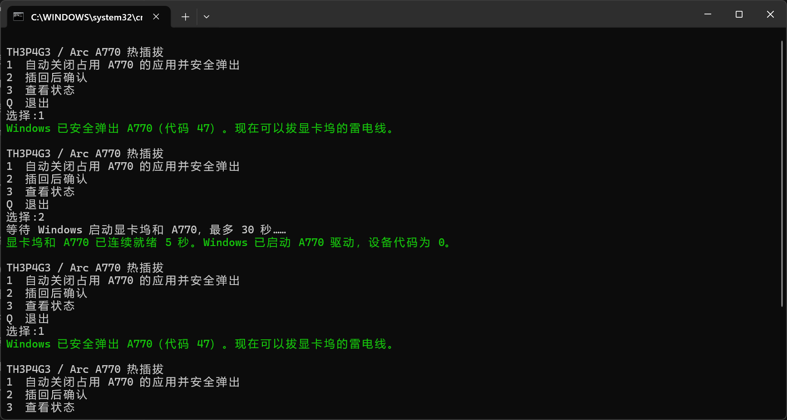

# TH3P4G3 + Arc A770 tools

中文快速开始 / English quickstart

完整排障记录与配图：[中文](https://github.com/ReclinedFish/th3p4g3-a770-egpu-diagnostics/blob/main/README.md) · [English](https://github.com/ReclinedFish/th3p4g3-a770-egpu-diagnostics/blob/main/README.en.md)

## 中文

将 ZIP 完整解压。热拔插工具需要 Windows 和 **PowerShell 7**（`pwsh.exe`）；不需要安装 .NET SDK。先接上 TH3P4G3 和 A770，双击 `tools/eGPU-Hotplug.cmd`。

工具默认根据 Windows 设备树识别受支持的 A770、显卡坞桥接设备及 USB 分支，无须手填设备实例路径；自动识别不会把这些路径写入配置。出现多个候选或不匹配的连接拓扑时会停止，不会猜测要弹出哪个设备。已有 `tools/eGPU-Hotplug.local.json` 时优先使用该配置；也可通过 `-ConfigPath` 指定配置。配置包含本机唯一标识，请保存在本地。

从解压后的目录执行以下命令可先查看状态和预演：

```powershell
.\tools\eGPU-Hotplug.cmd -Action Status
.\tools\eGPU-Hotplug.cmd -Action Eject -WhatIf
.\tools\eGPU-Hotplug.cmd
```

`-WhatIf` 只预演，不关闭应用或弹出设备。菜单 **1** 尝试关闭占用 A770 的应用，并请求 Windows 安全弹出；如果普通窗口应用提示保存，请先保存。工具可能终止已核实占用目标显卡的后台进程，以及为防止矿工重启而关闭 Kryptex 控制进程；`-ForceCloseApps` 还允许强制关闭未正常退出的窗口应用，使用前请保存工作。只有看到 **代码 47** 的成功提示才拔雷电线。插回后选 **2** 等待设备和驱动就绪，选 **3** 查看状态。接在坞上的其他 USB 或雷电设备仍受检查。

从 v0.2.0 起，**符合条件的鼠标接收器可自动放行**，不必拔下或手填白名单：工具审查每个直接连接 USB 设备的完整子树，要求 USB 硬件接口全为 HID、至少有一个标准鼠标集合，且所有节点在线正常。严格核对的软件组件叶节点可随同通过：它必须是已确认 `HidUsb` 接口下的 `SoftwareComponent`，具有预期类别、标识与厂商匹配关系，无关联功能驱动服务、无子设备且父关系正确；并非所有 `SWD` 都放行。“无关联功能驱动服务”不表示其软件包没有 Win32 服务，详见[接收器识别说明](https://github.com/ReclinedFish/th3p4g3-a770-egpu-diagnostics/blob/main/docs/usb-receiver-workaround.md#自动识别接收器与存储保护)。符合这些条件的有线鼠标也会放行；Windows 不能可靠区分其是否为无线接收器。移动硬盘、U 盘、UASP/SCSI 存储、磁盘/卷、额外 USB Hub、未知或未就绪节点，以及含非 HID 硬件功能的复合设备，仍会阻止弹出。旧 `AllowedUsbInstanceIds` 不能绕过这些检查。坞成功弹出后，接收器及其鼠标会暂时离线，可用触控板操作。

截图来自此前真实运行：



原生 DX11 复测另外需要 **.NET 10 SDK**。退出 Kryptex 后，从解压后的目录执行：

```powershell
dotnet build .\tools\Dx11ArcBatched\Dx11ArcBatched.csproj -c Release
.\tools\Test-Dx11Wake.ps1
```

ZIP 仅包含源码，不含编译后的 DX11 程序或第三方库；`dotnet build` 会按项目配置恢复 NuGet 依赖。日志写入 `tools/captures/`，可能含本机标识，公开前请脱敏。DX11 通过、整坞未掉线和未出现新的 141 是不同的检查项，请结合日志判断。

接收器绕过方法与适用范围见仓库的 [USB 接收器说明](https://github.com/ReclinedFish/th3p4g3-a770-egpu-diagnostics/blob/main/docs/usb-receiver-workaround.md)。它支持本机整坞空闲掉线的绕过，不证明 DX11/141 根因已修复。

## English

Extract the complete ZIP. The hot-plug tool needs Windows and **PowerShell 7** (`pwsh.exe`), but no .NET SDK. Connect the TH3P4G3 and A770, then open `tools/eGPU-Hotplug.cmd`.

By default, the tool identifies the supported GPU and dock topology from the Windows device tree without writing discovered paths to a configuration file. It stops on ambiguous or unsupported topology. An existing `tools/eGPU-Hotplug.local.json` overrides discovery; `-ConfigPath` selects another configuration. Keep device instance paths private.

Use the status and `-WhatIf` commands above before ejecting; `-WhatIf` does not close applications or eject devices. Menu **1** asks applications using the A770 to close, then requests Windows ejection. Ordinary windowed applications can wait for you to save pending work. Verified GPU-owning background processes may be terminated, as may the Kryptex controller to prevent its miner restarting. `-ForceCloseApps` additionally permits terminating windowed applications that do not close normally; save your work first. Unplug only after the tool confirms **code 47**. Reconnect and choose **2** to wait for the driver and devices; **3** shows their status. USB and downstream Thunderbolt accessory checks remain active.

Since v0.2.0, **compatible mouse receivers are accepted automatically**, without removal or a manual allowlist. Each directly connected USB device must have only HID hardware interfaces, a standard mouse collection in its complete subtree, and every node present and healthy. Strictly verified software-component leaves may accompany it: each must be a `SoftwareComponent` under a verified `HidUsb` interface, with expected class/identifiers and matching vendor, no associated function-driver service, no children and the correct parent. This is not blanket acceptance of `SWD` nodes. Absence of a function-driver service does not exclude Win32 services in the software package; see the [recognition guide](https://github.com/ReclinedFish/th3p4g3-a770-egpu-diagnostics/blob/main/docs/usb-receiver-workaround.en.md#automatic-receiver-recognition-and-storage-protection). A wired mouse meeting these conditions also passes; Windows cannot reliably distinguish it from a receiver. External drives, flash drives, UASP/SCSI storage, disks/volumes, additional USB hubs, unknown or unhealthy nodes, and composites containing non-HID hardware functions still block ejection. Legacy `AllowedUsbInstanceIds` entries cannot bypass these checks. A successful dock eject temporarily disconnects its receiver and mouse; use the laptop touchpad if needed.

Native DX11 testing additionally requires the **.NET 10 SDK**. Close Kryptex, build the project, then run `Test-Dx11Wake.ps1` using the commands above. This ZIP includes source, not a prebuilt DX11 executable; building restores the dependencies declared in the project. Logs in `tools/captures/` may contain private machine identifiers. Review the DX11 result and the separate disconnect/141 evidence before sharing a conclusion.

The console image shows a previous real eject/reconnect; it does not establish a new physical unplug test for this version. See the [v0.2.0 release notes](https://github.com/ReclinedFish/th3p4g3-a770-egpu-diagnostics/blob/main/docs/release-v0.2.0.md) for validation scope and the [receiver guide](https://github.com/ReclinedFish/th3p4g3-a770-egpu-diagnostics/blob/main/docs/usb-receiver-workaround.en.md) for classification and workaround limits. This is not an established fix for intermittent DX11 failures.

## Release integrity and license

Compare `Get-FileHash .\th3p4g3-a770-tools-v0.2.0.zip -Algorithm SHA256` with the accompanying `.sha256` file. A matching hash checks file integrity, not publisher identity; these scripts are not code-signed.

Tool source is licensed under the [MIT License](https://github.com/ReclinedFish/th3p4g3-a770-egpu-diagnostics/blob/main/tools/LICENSE). The package excludes private configuration, captures, dumps, binaries, and repository metadata.

Maintainers can rebuild the allowlisted ZIP with `pwsh -NoProfile -File .\tools\Build-Release.ps1`. Output defaults to a `release-artifacts` directory beside the checkout. `-OutputDirectory` selects another directory, and `-Force` replaces an existing generated ZIP/checksum pair. Rebuilding the same input bytes with the same .NET runtime produces the same archive hash.
